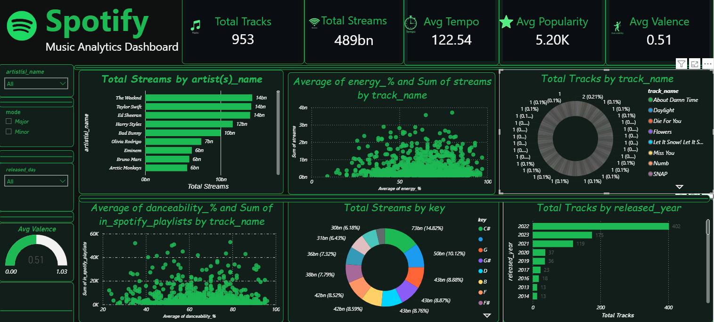

# 🎵 Spotify Music Analytics Dashboard

An interactive and visually engaging **Power BI Dashboard** designed to analyze Spotify streaming data, track performance, audio features, and artist analytics.



---

## 📌 Project Overview
This project provides deep insights into Spotify's music dataset. By leveraging **Power BI** and **DAX**, raw streaming data was transformed into an executive-level analytics dashboard featuring custom dark-mode visuals, dynamic slicers, and audio feature correlations.

---

## 📊 Key Features & Visual Insights

- **Executive KPI Cards:** Quick high-level overview metrics including **Total Tracks**, **Total Streams**, **Average Tempo**, **Average Popularity**, and **Average Valence**.
- **Top Artists Analytics:** Horizontal bar chart highlighting top-performing artists sorted by total streams (e.g., The Weeknd, Taylor Swift, Ed Sheeran).
- **Audio Feature Scatter Plots:** 
  - `Energy (%)` vs. `Total Streams` to analyze track intensity against popularity.
  - `Danceability (%)` vs. `Spotify Playlists` inclusion.
- **Track Distribution:** Categorized track counts by `Release Year` and key audio metrics (`Key`, `Mode`).
- **Interactive Filtering (Slicers):** Dynamic slicers for filtering by `Artist Name`, `Mode` (Major/Minor), `Release Day`, and time periods.

---

## 🛠️ Tools & Technologies Used

- **Business Intelligence:** Microsoft Power BI
- **Data Query & Transformation:** Power Query, SQL, Python
- **Calculations:** DAX (Data Analysis Expressions)
- **Design & Formatting:** Custom Dark Theme (`#1DB954` Spotify Neon Green Accent Palette)

---

## 📂 Project Structure

```text
├── spotify-Dashboard.csv    # Raw / Cleaned Spotify dataset
├── Spotify_Dashboard.png    # Dashboard screenshot
└── README.md                # Project documentation
